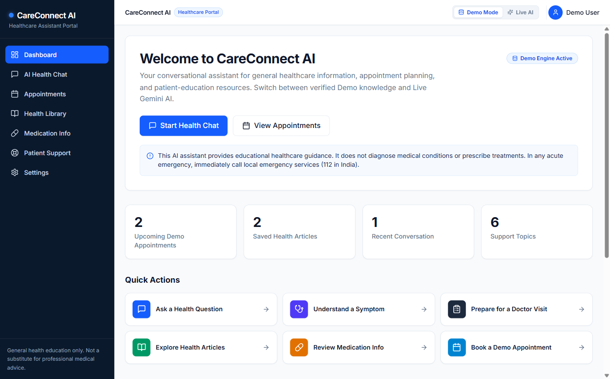
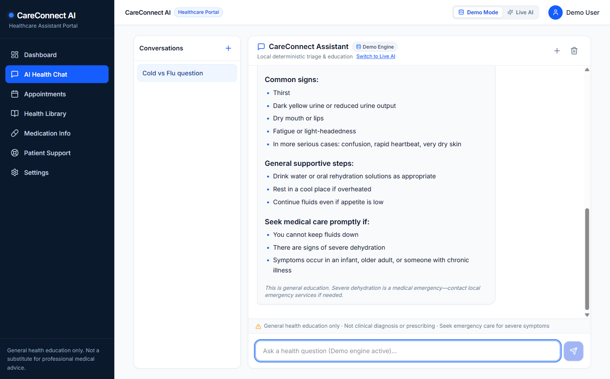
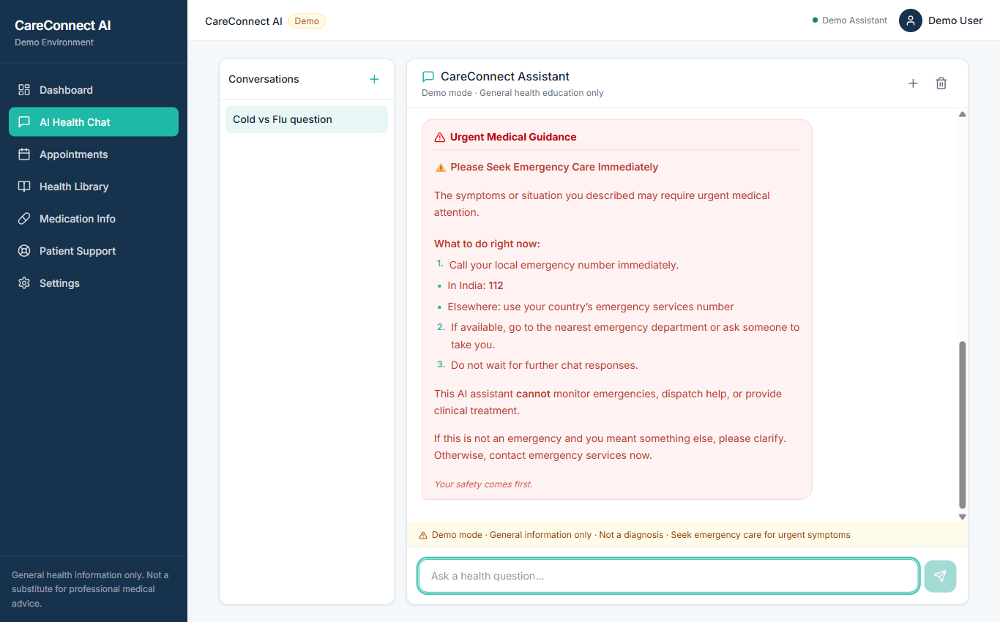
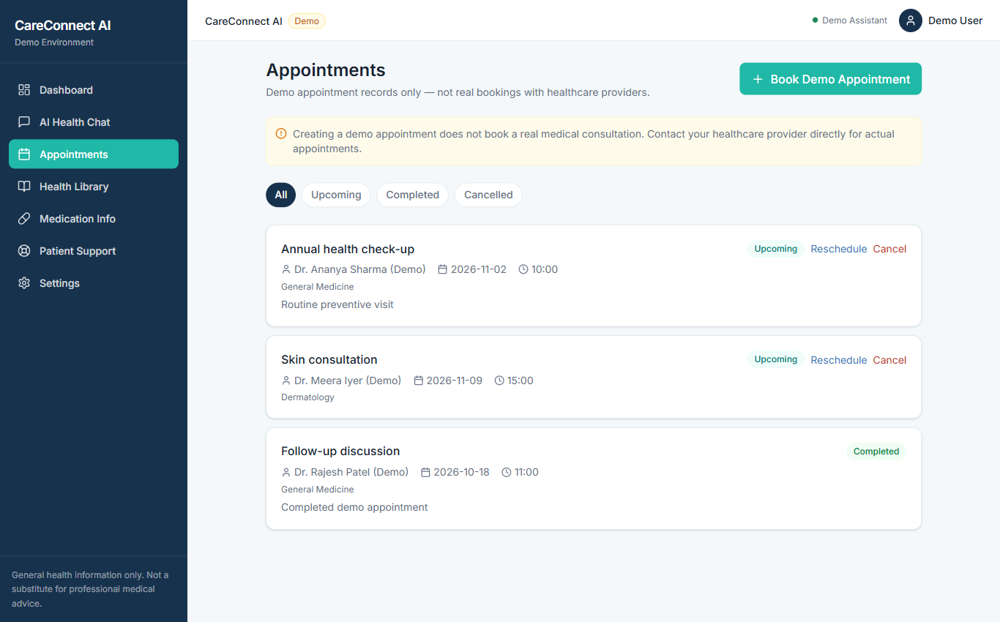
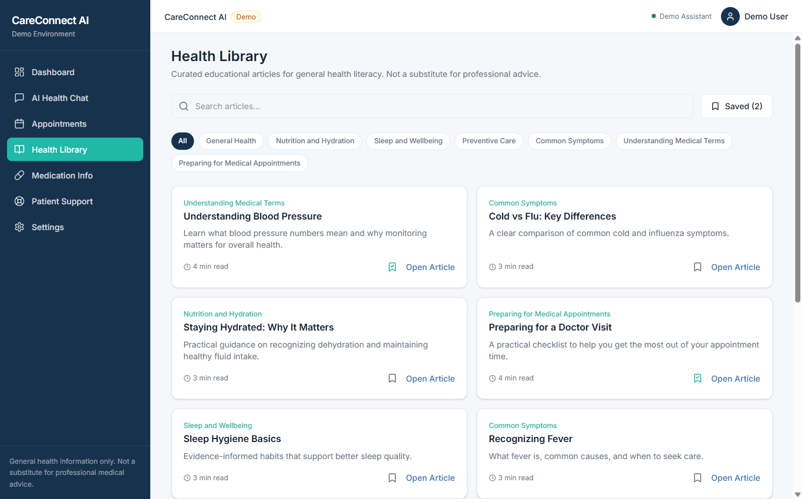
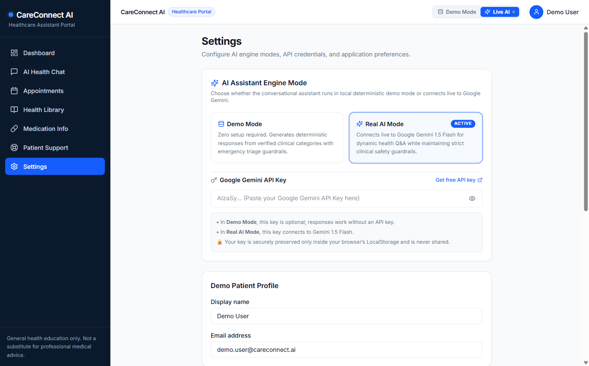

# CareConnect AI

[](LICENSE)
[](https://www.typescriptlang.org/)
[](https://react.dev/)
[](https://vitejs.dev/)
[](https://tailwindcss.com/)

**CareConnect AI** is a modern, responsive conversational healthcare assistant and patient support web portal built with React 19, TypeScript, Vite, and Tailwind CSS. It is engineered with a **Dual-Engine AI architecture** that operates either 100% offline via a deterministic clinical triage engine or live with Google Gemini 1.5 Flash.

> **Medical Disclaimer**: CareConnect AI provides general educational health information, symptom navigation support, and clinic visit preparation. It **does not** provide medical diagnoses, treatment prescriptions, or clinical decision-making. In case of acute or emergency medical symptoms, users are immediately directed to dial local emergency services (e.g., 911).

---

## Key Features

### 1. Dual-Engine Conversational AI
- **Demo Mode (Offline / Simulated)**: Fully functional without API keys or internet connection. Features a deterministic clinical decision rules engine, keyword taxonomy matching, categorized follow-ups, and instant red-flag emergency detection.
- **Real AI Mode (Google Gemini 1.5 Flash)**: Connects directly to Google Generative AI (`gemini-1.5-flash`) via user-provided API key stored in `localStorage`. Configured with rigorous clinical safety system prompts and active fallback to the offline engine if network or quota limits arise.
- **One-Click Engine Toggle**: Switch between Demo and Real AI seamlessly from the top navigation bar, the chat interface, or the settings dashboard.

### 2. Clinical Emergency Triage & Safety System
- Automatic detection of emergency red-flag triggers (e.g., chest pain, shortness of breath, sudden numbness, severe head trauma).
- Prominently displays high-priority emergency alerts with direct 911 guidance, disabling automated text when emergency thresholds are triggered.
- Persistent disclaimer badges and clinical context on all health conversations.

### 3. Patient Appointment Management
- Demo booking system for primary care, cardiology, dermatology, and routine follow-up consultations.
- Filter appointments by status (`All`, `Upcoming`, `Completed`, `Cancelled`).
- Reschedule, cancel, and generate personalized doctor-visit preparation checklists.

### 4. Curated Health & Wellness Library
- 12 verified educational articles spanning Preventative Health, Chronic Care Management, Mental Wellness, and Nutrition.
- Real-time full-text search and category filtering.
- Full-screen article reading modal with reading time estimates, key takeaways, and bookmarking to local state.

### 5. Medication Education Directory
- Educational lookup for common medications (e.g., Lisinopril, Metformin, Atorvastatin, Amoxicillin, Albuterol).
- Details typical dosing schedule, food intake guidelines, potential side effects, and precautions.
- One-click **"Ask AI about this medication"** shortcut that initiates context-aware health chat conversations.

### 6. Patient Support & Visit Preparation
- Interactive interactive visit checklist (e.g., symptom timeline, current medication list, insurance cards, questions for physician).
- Expandable FAQ accordion addressing common portal and clinical logistics questions.
- Emergency contacts directory and crisis hotlines (Emergency 911, Suicide & Crisis Lifeline 988, Poison Control 1-800-222-1222).

### 7. Accessibility & UI Customization
- Built with high-contrast clinical color tokens: Clinical Sapphire (`#2563EB`) and Obsidian Slate (`#0B192C` / `#0F172A`).
- Accessibility controls for **Large Text Mode** (18px root base scale) and **Reduced Motion**.
- Fully responsive design tested across desktop, tablet, and mobile viewport breakpoints.

---

## Visual Tour & Screenshots

A complete documentation gallery is available in [`docs/SCREENSHOTS.md`](docs/SCREENSHOTS.md).

| Dashboard Overview | AI Health Chat & Mode Toggle |
| :---: | :---: |
|  |  |

| Emergency Triage Detection | Appointment Management |
| :---: | :---: |
|  |  |

| Health Library Catalog | Settings & Accessibility |
| :---: | :---: |
|  |  |

---

## Technology Stack

| Layer | Technologies |
| :--- | :--- |
| **Frontend Framework** | React 19 (`react`, `react-dom`) |
| **Language & Typing** | TypeScript 5.8 |
| **Build & Tooling** | Vite 6.3 (`@vitejs/plugin-react`) |
| **Styling & Design System** | Tailwind CSS v4 (`@tailwindcss/vite`), Custom CSS utility layers |
| **Routing** | React Router v7 (`react-router-dom`) |
| **Icons & Visuals** | Lucide React (`lucide-react`) |
| **AI Integration** | Google Generative AI (Gemini 1.5 Flash REST API) + Deterministic Clinical Rule Engine |
| **Client Persistence** | Browser `localStorage` (Zero external database required for demo) |
| **Code Quality** | TypeScript compiler (`tsc --noEmit`), Oxlint (`.oxlintrc.json`) |

---

## Project Structure

```
careconnect-ai/
├── docs/
│   ├── SCREENSHOTS.md               # Complete visual documentation catalog
│   └── screenshots/                # 12 verified high-resolution application screenshots
│       ├── 01-dashboard-overview.png
│       ├── 02-dashboard-recent-activity.png
│       ├── 03-ai-health-chat.png
│       ├── 04-emergency-triage-alert.png
│       ├── 05-appointments-management.png
│       ├── 06-appointment-booking-modal.png
│       ├── 07-health-library-catalog.png
│       ├── 08-article-reader-modal.png
│       ├── 09-medication-directory.png
│       ├── 10-medication-details-questions.png
│       ├── 11-patient-support-checklist-faq.png
│       └── 12-settings-accessibility.png
├── public/
│   └── favicon.svg                  # SVG healthcare cross branding icon
├── src/
│   ├── components/
│   │   ├── Layout.tsx               # Main app layout wrapper with responsive sidebar
│   │   ├── Sidebar.tsx              # Primary navigation sidebar
│   │   └── TopBar.tsx               # Top header with engine pill switch and user avatar
│   ├── context/
│   │   └── AppContext.tsx           # Global state (appointments, bookmarks, chat, settings)
│   ├── data/
│   │   ├── articles.ts              # Curated educational health articles dataset
│   │   ├── medications.ts           # Educational medication database
│   │   └── seed.ts                  # Default mock appointments, user profile, and triage taxonomy
│   ├── pages/
│   │   ├── Appointments.tsx         # Appointment scheduling and status filters
│   │   ├── Chat.tsx                 # Interactive conversational assistant with emergency checks
│   │   ├── Dashboard.tsx            # Patient portal dashboard with metrics and quick actions
│   │   ├── HealthLibrary.tsx        # Searchable and categorized educational library
│   │   ├── Medications.tsx          # Medication directory and AI question shortcuts
│   │   ├── PatientSupport.tsx       # Pre-visit checklist, FAQ accordion, and hotlines
│   │   └── Settings.tsx             # AI Engine switch, Gemini API key configuration, accessibility
│   ├── types/
│   │   └── index.ts                 # TypeScript domain models and interfaces
│   ├── utils/
│   │   ├── chatEngine.ts            # Dual-engine triage router (Deterministic + Gemini 1.5 Flash)
│   │   └── storage.ts               # LocalStorage abstraction with fallback handling
│   ├── App.tsx                      # Application router and route definitions
│   ├── index.css                    # Tailwind CSS v4 imports and custom styling rules
│   └── main.tsx                     # Application DOM mount entry point
├── .gitignore                       # Git ignore specifications
├── .oxlintrc.json                   # Oxlint linting configuration
├── index.html                       # HTML5 entry page
├── LICENSE                          # MIT License
├── package.json                     # Project manifest and dependencies
├── tsconfig.json                    # TypeScript compiler configuration
└── vite.config.ts                   # Vite configuration
```

---

## Getting Started

### Prerequisites
- **Node.js**: v18.0.0 or higher (v20+ recommended)
- **npm**: v9.0.0 or higher (or `pnpm` / `yarn`)

### Installation
1. Clone the repository:
   ```bash
   git clone https://github.com/premkumarsenthilkumar/Care-Connect-AI.git
   cd Care-Connect-AI
   ```

2. Install dependencies:
   ```bash
   npm install
   ```

3. Launch development server:
   ```bash
   npm run dev
   ```

4. Open your browser at the displayed local URL (default: `http://localhost:5180` or `http://localhost:5173`).

---

## Configuration

CareConnect AI runs out-of-the-box in **Demo Mode** without any API key or backend service.

### Setting Up Live Google Gemini AI (Optional)
To activate live LLM capabilities with Google Gemini 1.5 Flash:
1. Obtain a free Google Gemini API key from [Google AI Studio](https://aistudio.google.com/).
2. Open CareConnect AI in your browser.
3. Navigate to **Settings** -> **AI Assistant Engine**.
4. Select **Real AI Mode (Google Gemini)** and paste your API key into the input field.
5. Click **Save Settings**. Your API key is stored securely in your browser's `localStorage` and never leaves your client machine except to call Google's official Gemini endpoint.

---

## Verification & Build

### Type Check
Validate TypeScript types across the entire project:
```bash
npx tsc -b
```

### Production Build
Compile and bundle the production single-page application into `dist/`:
```bash
npm run build
```

### Preview Production Build
Serve the compiled distribution build locally:
```bash
npm run preview
```

---

## Releases & Downloads

Pre-built application archives and release bundles are distributed via GitHub Releases:
- **Latest Release**: [CareConnect AI v1.0.0](https://github.com/premkumarsenthilkumar/Care-Connect-AI/releases/latest)
- Web Distribution Archive: `CareConnect-AI-v1.0.0-web.zip`
- Checksums: `checksums.txt` (SHA-256)

---

## Limitations

- **Not a Diagnostic Tool**: CareConnect AI does not connect to Electronic Health Record (EHR) systems and cannot verify patient medical histories.
- **Client-Side Persistence**: In the current single-page architecture, all changes (appointments, chat history, bookmarks) persist in browser `localStorage`. Clearing browser data resets state to the default seed dataset.
- **Offline Mode Scope**: The offline demo engine uses clinical keyword taxonomy matching and does not generate novel synthetic text.

---

## Contributing

1. Fork the repository.
2. Create a feature branch (`git checkout -b feature/clinical-enhancement`).
3. Commit your changes (`git commit -m "Add clinical enhancement"`).
4. Push to the branch (`git push origin feature/clinical-enhancement`).
5. Open a Pull Request.

---

## License

This project is licensed under the terms of the [MIT License](LICENSE).

Copyright (c) 2026 Premkumar S.
